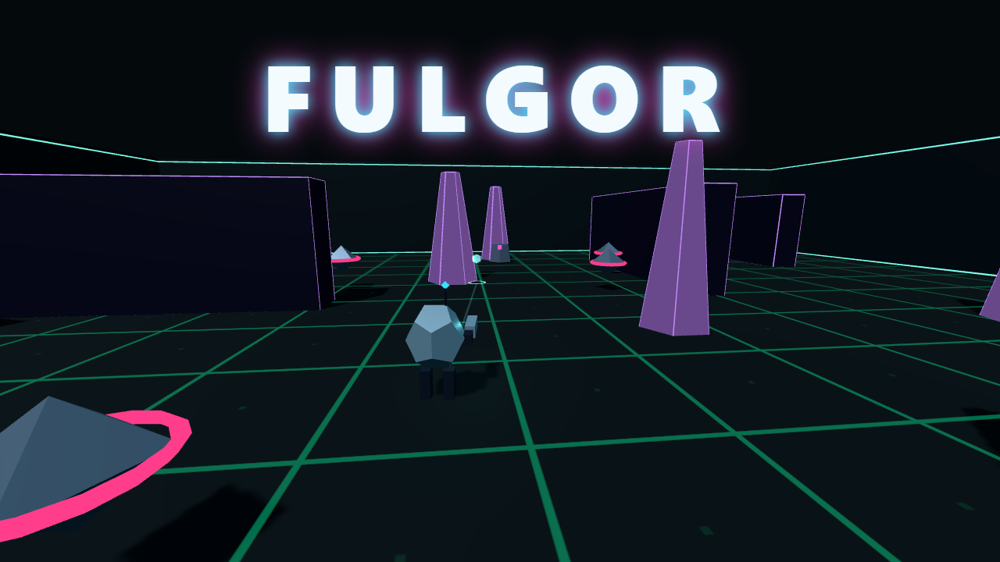

# Fulgor

Shooter de arena en tercera persona con estilo low-poly neón. Eres **Chispa**, una pequeña unidad de combate con un arma de energía, atrapada en arenas llenas de máquinas hostiles: sobrevive a las oleadas, elige mejoras entre ronda y ronda y derrota al **Coloso**.

**Jugar:** https://dannnyusssssss.github.io/Fulgor/



## Cómo se juega

- **Oleadas:** 10 oleadas por arena, con el Coloso en la última. Entre oleadas eliges 1 de 3 mejoras. Completar una arena desbloquea la siguiente.
- **Resistencia:** oleadas sin fin, cada vez más duras, con el Coloso cada 10 oleadas. Se desbloquea en cada arena al completarla en el modo Oleadas.
- **Arenas:** Hangar Cobalto (abierta, con coberturas), Fundición Ámbar (campos de energía que se activan con aviso) y Jardín de Cristal (espacios estrechos).
- **Armas:** Pulsador (disparo preciso), Dispersor (abanico corto) y Rayo (haz continuo). No usan munición, sino **calor**: si se sobrecalientan se bloquean un momento; ventilar enfría más rápido.
- **Habilidades:** Onda (empuja), Barrera (escudo temporal) y Señuelo (distrae). Se elige una por partida.
- **Dificultad:** Fácil, Normal y Difícil.

Todo ataque enemigo se avisa antes con una forma, una línea o un anillo visibles. Los enemigos son máquinas y, al derrotarlas, se deshacen en fragmentos de luz: no hay sangre ni imágenes explícitas.

## Controles

| Acción | Teclado y ratón | Mando |
|---|---|---|
| Moverse | W A S D | Stick izquierdo |
| Girar la cámara | Ratón o flechas ← → ↑ ↓ | Stick derecho |
| Disparar | Clic izquierdo o Espacio | RT |
| Apuntar con precisión | Clic derecho | LT |
| Esquivar | Shift | A o B |
| Ventilar el arma | R | X |
| Habilidad | Q | Y o LB |
| Cambiar de arma | 1, 2, 3 | Cruceta (izquierda, arriba, derecha) |
| Cambiar de hombro | C | RB |
| Pausa | Esc o P | Start |
| Silencio | M | — |

Al pulsar "Jugar" el juego captura el puntero del ratón. Si el navegador no lo permite, se puede jugar girando con las flechas.

## Accesibilidad y comodidad

- **Reducir destellos** y **Reducir movimiento** (en el inicio, en la pausa y en los ajustes). Se activan solos si el sistema tiene activada la preferencia de reducir movimiento. Ningún destello supera 3 por segundo.
- Campo de visión, sensibilidad, inversión del eje vertical y calidad gráfica ajustables. **Resolución dinámica** opcional.
- **Apuntado asistido** y **disparo automático** (una pulsación lo activa o lo detiene).
- Se puede jugar sin sonido: las señales importantes también se ven en pantalla.

## Datos que guarda

El juego no recoge datos personales ni se conecta a ningún servicio. Solo guarda en el propio navegador, en la clave `fulgor:v1` de `localStorage`, los ajustes, el progreso, las mejores puntuaciones y la última semilla. Para borrarlos basta con borrar los datos del sitio en el navegador.

## Requisitos

Un navegador actual con WebGL (Chrome, Edge, Firefox o Safari recientes). Teclado y ratón, o mando compatible con el navegador.

## Desarrollo

Requiere Node.js 24.

```
npm ci             # instala las dependencias exactas del lockfile
npm run dev        # servidor de desarrollo
npm run test       # tests de la lógica (vitest)
npm run lint       # análisis estático (eslint)
npm run build      # comprobación de tipos y paquete en dist/
npm run preview    # sirve dist/ para probar el paquete final
```

Tecnología: TypeScript, Three.js (WebGL) y Vite. La lógica del juego es independiente del render y se prueba con simulaciones deterministas.

## Publicación

El workflow `.github/workflows/deploy.yml` corre lint, tests y build en cada push a `main` y publica `dist/` en GitHub Pages. Para activarlo, en el repositorio: **Settings → Pages → Source: GitHub Actions**.

`dist/` es estático y usa rutas relativas, así que funciona en cualquier hosting estático y dentro de un iframe.

## Licencia

Todos los derechos reservados. Titular: Danny Sivinta.

El arte (geometría procedural y texturas dibujadas con Canvas) y el sonido (sintetizado con WebAudio) son propios. Three.js se distribuye con licencia MIT; ver [docs/LICENSES.md](docs/LICENSES.md).
